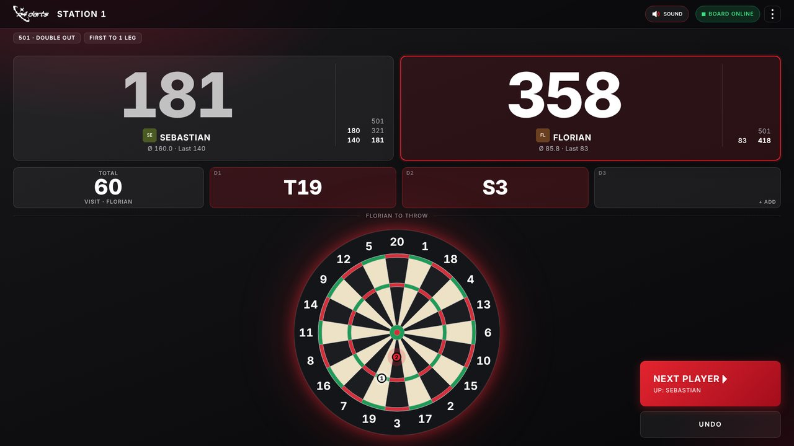
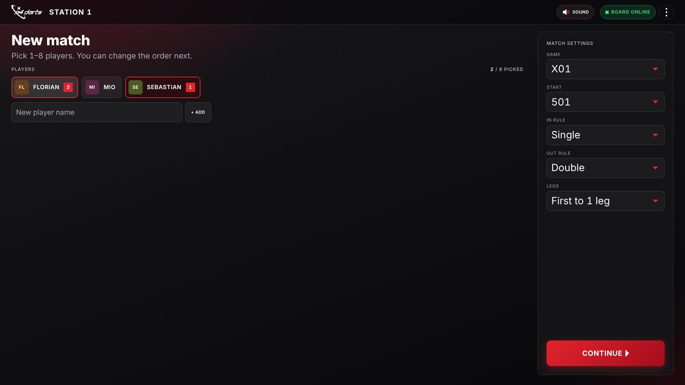
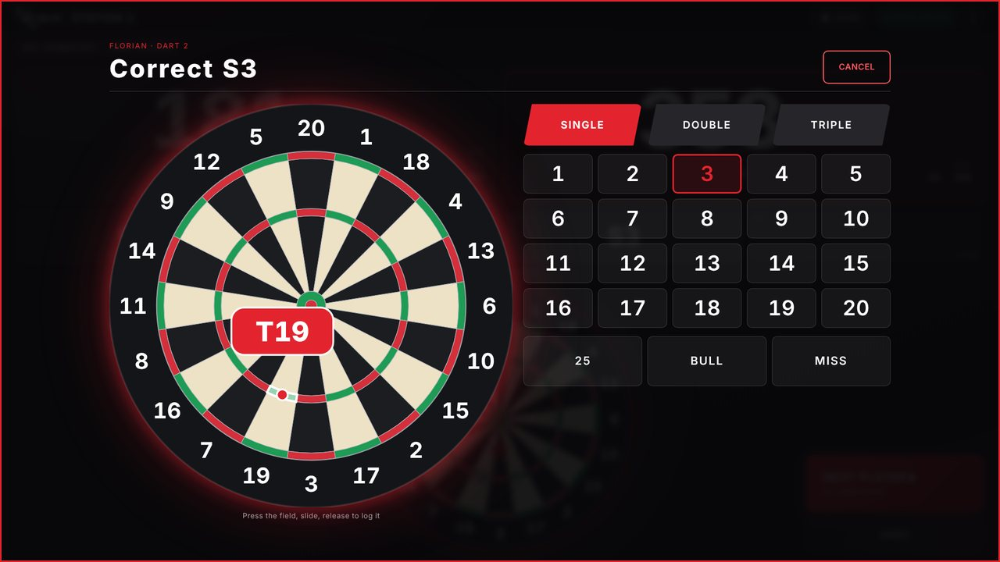
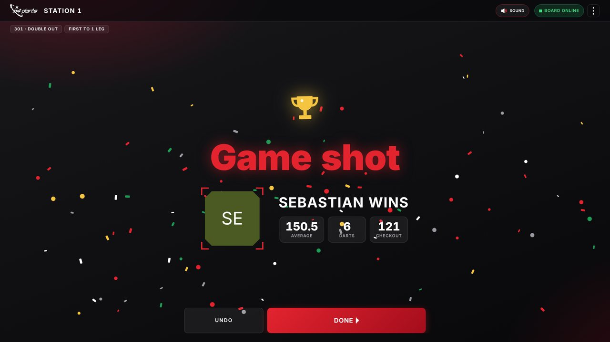
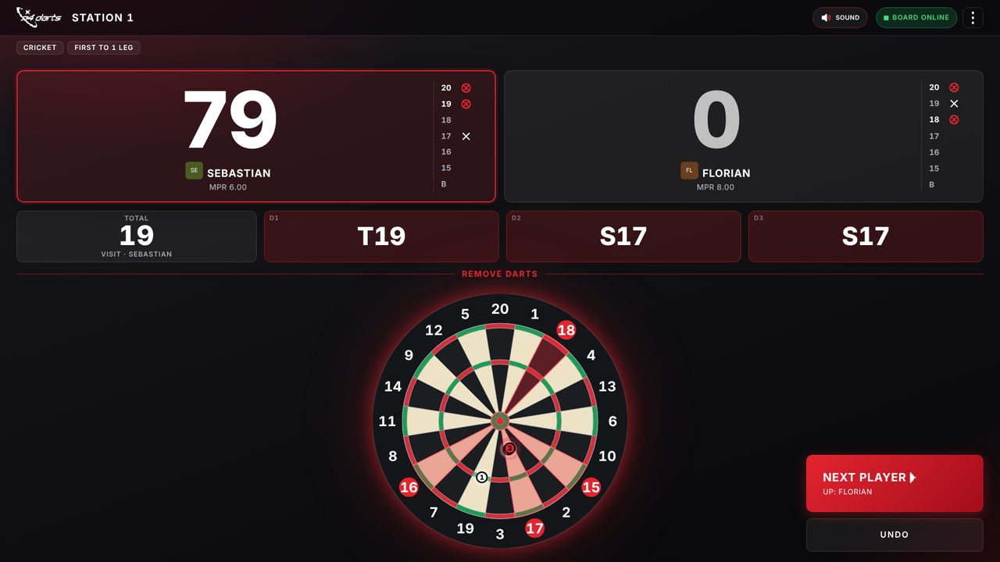
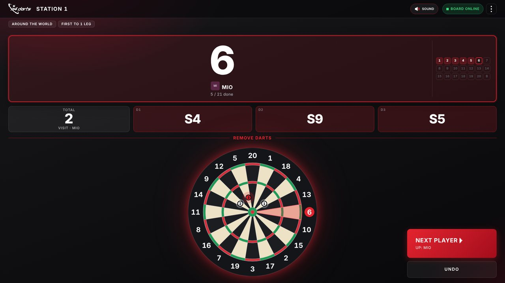
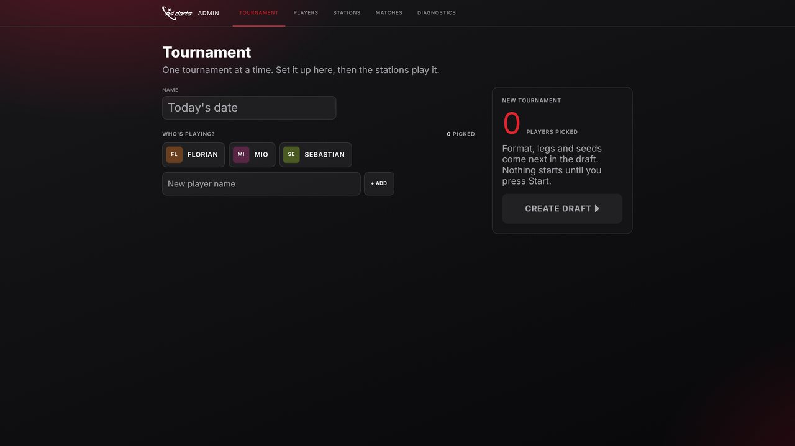
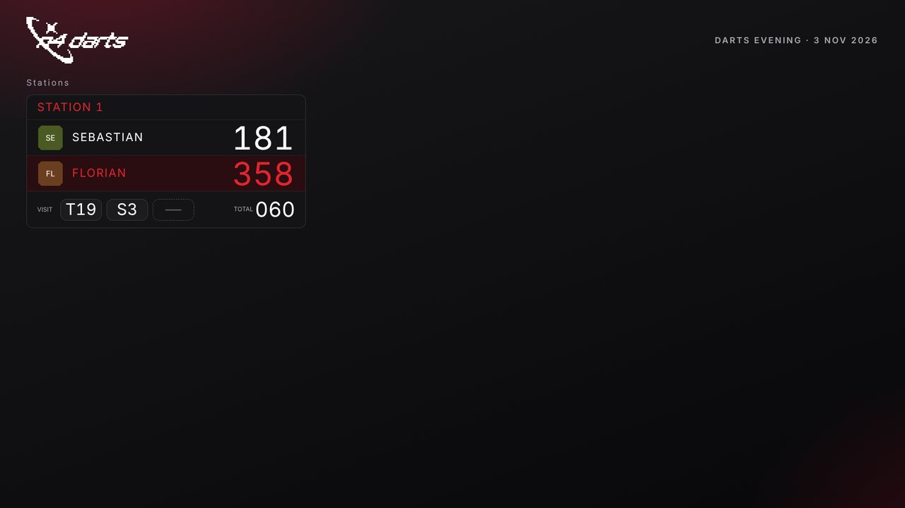
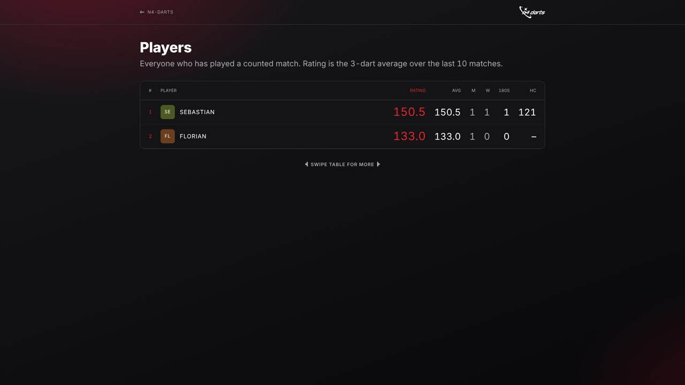

# Offline Darts – Dein Darts-Abend. Ohne Internet.

**Autodarts sieht. Offline Darts zählt.** Der Autodarts Board Manager 2.0.2 erkennt die Pfeile,
Offline Darts macht den Rest: Spiele, Turniere, Statistiken, Beamer-Ansicht – komplett ohne Internet.

> Die gleiche Anleitung als gestaltete Seite: [`docs/anleitung.html`](docs/anleitung.html)
> (liegt auch in jedem Download-Paket als `anleitung.html`).

**Download:** [Releases → „Neuester Stand“](../../releases/tag/neuester-stand) –
`offline-darts-windows.zip` für Windows, `offline-darts-linux.tar.gz` für Linux.



---

## 01 · Funktionen

| | |
|---|---|
| **Komplett offline** | Schriften, Icons, Skripte – alles wird mitgeliefert. Nichts lädt aus dem Netz, nichts muss in eine Cloud. |
| **Vier Spiele, auch solo** | X01 mit 301, 501 oder 701 (In: Single, Double, Master, Bull · Out: Single, Double, Master), Cricket, Around the World und Elimination. Allein zum Trainieren oder mit 2–8 Spielern, First to 1–5 Legs. |
| **Turniere auf Autopilot** | Gruppenphase, dann K.-o. (einfach oder doppelt). Der Server setzt das nächste Match automatisch an deine Scheibe. |
| **Beamer-Ansicht** | Live-Stände, Gruppentabellen, Turnierbaum und am Ende Sieger und Awards. |
| **Statistiken für immer** | Rangliste, 3-Dart-Schnitt, Checkout-Quote, 180er, bestes Leg – dazu je Spiel Siege, Darts und Cricket-MPR. Alles lokal, lesbar in `data/spieler-stats.json`. |
| **Korrigieren mit dem Finger** | Falschen Pfeil antippen, Finger auf die große Scheibe, aufs richtige Feld ziehen – eingetragen wird erst beim Loslassen. Daneben loslassen bricht ab. Fehlende Pfeile lassen sich nachtragen. |
| **Die Scheibe im Blick** | Jeder Pfeil erscheint nummeriert genau dort, wo Autodarts ihn gesehen hat. Bei Around the World leuchtet das nächste Ziel, bei Cricket die offenen Zahlen. Checkout-Wege stehen in den freien Wurf-Feldern. |
| **Sieg mit Show** | Game shot mit Konfetti in Rot, Weiß und Gold, Pokal und den Zahlen des Siegers: Average, Darts, Checkout – auch auf dem Beamer. |
| **Töne an oder aus** | Ein Ton pro Pfeil (Single, Double, Triple, Bull und Miss klingen verschieden), ein Gong für den nächsten Spieler, Brummen beim Bust, Fanfare beim Sieg. Ein Knopf oben schaltet alles stumm. |

## 02 · Das Prinzip

Auf dem PC an der Scheibe läuft der **Autodarts Board Manager 2.0.2** als reiner Pfeil-Detektor.
Offline Darts läuft daneben auf demselben PC, holt sich jeden Wurf über dessen lokale Schnittstelle
(**Port 3180**) ab und kümmert sich um alles andere. Ausgelegt für genau einen Dartautomaten.

```
 Autodarts 3-Kamera-Set ──► Board Manager 2.0.2 (:3180) ──Würfe──► Offline-Darts-Server (:3000)
                                       ▲                          │  Spielregeln & Korrekturen
                                       └──── Start/Stop ──────────┤  Turniere & Statistiken
                                                                  │  Datenbank & tägliche Backups
                                                                  ▼
          Touchmonitor /station/1 · Beamer /display · Handys /players · Orga /admin
```

Kein Login, keine Konten: Jede Station ist einfach eine Adresse. Wer im selben Netz ist,
öffnet die Seite im Browser.

## 03 · Anleitung – in 6 Schritten zum ersten Leg

### 1. Das brauchst du

- Dartscheibe mit Autodarts-Kamera-Set (z. B. Winmau Autodarts) und einen PC mit dem
  Autodarts Board Manager in **genau Version 2.0.2 – nicht aktualisieren**
- Sonst nichts: Offline Darts läuft auf demselben PC wie Autodarts (Windows oder Linux)
- Optional ein WLAN-Router, wenn Handys oder ein Beamer mitspielen sollen – Internet nicht nötig
- Optional: Beamer oder Fernseher, ein Handy für den Organisator

### 2. Wichtig: Autodarts offline einrichten – ohne Login

Normalerweise will der Board Manager beim ersten Start eine Anmeldung. Damit du dich nie
einloggen musst und alles komplett offline läuft:

1. Autodarts Board Manager 2.0.2 installieren.
2. Die zwei Config-Dateien in den Autodarts-Ordner kopieren:
   - Windows: `%APPDATA%\[AUTODARTS-ORDNER]` (im Explorer `%APPDATA%` in die Adresszeile eingeben)
   - Linux: der entsprechende Ordner des Board Managers (meist unter `~/.config/`) – `[AUTODARTS-ORDNER]`
3. In den Config-Dateien deine drei Kameras eintragen.
4. Board Manager starten – er läuft jetzt ohne Anmeldung und ohne Internet.

`[CONFIG-DATEI 1]` · `[CONFIG-DATEI 2]`

### 3. Herunterladen & starten

**Windows**

1. Unter [Releases → „Neuester Stand“](../../releases/tag/neuester-stand) die Datei
   `offline-darts-windows.zip` herunterladen.
2. Die ZIP entpacken, z. B. auf den Desktop.
3. **`Darts starten.cmd`** doppelklicken. Fehlt Node.js, wird es automatisch installiert.
4. Frage nach der Autodarts-Adresse: einfach **Enter**, wenn Autodarts auf demselben PC läuft.
5. Der Browser öffnet <http://localhost:3000/station/1> – fertig. Im Fenster steht, ob Autodarts
   gefunden wurde.

**Linux**

```bash
tar -xzf offline-darts-linux.tar.gz
cd offline-darts
./darts-starten.sh        # mit dem echten Board (fragt nach der Adresse, Enter = dieser PC)
./darts-simulator.sh      # zum Ausprobieren mit einer Scheibe zum Anklicken
```

- Fehlt Node.js 22+, lädt das Skript es einmalig in den Ordner `node` – ohne Root-Rechte
  (x64 und arm64, also auch Raspberry Pi).
- Autostart beim Einschalten: `./autostart.sh` – mit `./autostart.sh --kiosk` öffnet sich
  nach dem Anmelden zusätzlich die Station im Vollbild (Chromium/Chrome/Firefox).
  Abschalten: `./autostart.sh --entfernen`.
- Ohne Fenster/Browser starten (z. B. per SSH): `./darts-starten.sh --board 192.168.178.50 --no-browser`

**Aktualisieren:** neues Paket von „Neuester Stand“ entpacken und den Ordner **`data`** behalten –
darin liegen Spieler, Spiele und Statistiken. Liegt der neue Ordner `offline-darts` neben einem
alten Ordner `n4-darts`, übernimmt der erste Start dessen `data` automatisch. GitHub baut die
Pakete bei jeder Änderung neu.

### 4. Station im Vollbild

Auf dem PC an der Scheibe ist <http://localhost:3000/station/1> schon offen. Mit **F11** auf
Vollbild stellen. Oben zeigt eine Anzeige **„Board online“**. Über das ⋮-Menü daneben startest
oder stoppst du die Erkennung, kalibrierst und setzt das Board zurück – ohne den Kiosk zu verlassen.
Daneben schaltet **Sound** die Töne ein und aus.

### 5. Spieler anlegen

<http://localhost:3000/admin> öffnen (ggf. PIN eingeben) und unter **Players** Namen eintragen.
Avatar antippen, um ein Foto mit der Kamera aufzunehmen und rund zuzuschneiden. Spieler lassen
sich auch direkt an der Station hinzufügen (Feld *New player name* → **+ Add**).

### 6. Spielen

1. An der Station 1 bis 8 Spieler antippen – auch alleine zum Trainieren. Die Reihenfolge der
   Taps ist die Wurfreihenfolge.
2. Rechts unter **Game** das Spiel wählen: X01, Cricket, Around the World oder Elimination. Bei X01
   Startpunkte (301/501/701), In- und Out-Regel, dazu die Legs. Dann **Continue** und **Start**.

   

3. Werfen. Jeder Pfeil erscheint sofort nummeriert auf der Scheibe im Bildschirm, darüber der
   Punktestand aller Spieler und die drei Wurf-Felder mit Summe und Checkout-Vorschlag.
4. Pfeile ziehen beendet die Aufnahme – erst dann ist der nächste Spieler dran. Alternativ
   **Next player** antippen; **Undo** nimmt den letzten Schritt zurück.
5. Pfeil falsch erkannt? Antippen (in der Wurf-Leiste oder direkt auf der Scheibe), Finger aufs
   richtige Feld ziehen und loslassen. Die Blase zeigt beim Ziehen, welches Feld eingetragen wird;
   rechts geht es alternativ per Tasten (Single/Double/Triple + Zahl, Bull, Miss).

   

6. Beim Checkout gibt es Konfetti und die Zahlen des Siegers – mit **Done** geht es zum nächsten
   Spiel.

   

**Cricket und Around the World:** Bei Cricket zeigt jede Spielerkarte die Marks auf 20 bis 15 und
Bull; die noch offenen Zahlen leuchten auf der Scheibe. Bei Around the World leuchtet das nächste
Ziel, die Karte zeigt den Fortschritt (1 bis 20, dann Bull).

| Cricket | Around the World |
|---|---|
|  |  |

## 04 · Turnierabend – einrichten, starten, zurücklehnen

Alles läuft über <http://localhost:3000/admin> → **Tournament**, bequem vom Handy aus.



- **Aufsetzen:** Spieler wählen, *Create draft*. Format, Legs pro Phase und Spiel einstellen.
  Setzliste nach Schnitt, geschätzte Dauer inklusive.
- **Starten:** Ab jetzt führt der Server durch den Abend: nächstes Match direkt an die Scheibe,
  K.-o.-Baum nach der Gruppenphase, Sieger rücken auf.
- **Eingreifen:** Station pausieren, Match zurückhalten oder vorziehen, Spieler abmelden,
  Nachzügler aufnehmen, Würfe im Verlauf korrigieren.
- **Siegerehrung:** Champion, Platzierungen und Awards: bester Match-Schnitt, höchstes Finish,
  meiste 180er, bestes Leg.

**Beamer-Tipp:** <http://localhost:3000/display> im Browser für den Beamer öffnen, F11, fertig.
Die Seite folgt dem Abend von selbst. Eine Station groß zeigen: <http://localhost:3000/watch/1>.

| Beamer (`/display`) | Rangliste (`/players`) |
|---|---|
|  |  |

## 05 · Alle Seiten – wo was läuft

| Adresse | Gerät | Wofür |
|---|---|---|
| `http://localhost:3000/station/1` | Touchmonitor an der Scheibe | Match starten, Punktestand, Pfeile korrigieren |
| `http://localhost:3000/admin` | Handy des Organisators | Turnier, Spieler, Verlauf, Board-Adresse |
| `http://localhost:3000/display` | Beamer | Live-Stände, Tabellen, Turnierbaum, Rangliste |
| `http://localhost:3000/watch/1` | Beamer / TV | Eine Station groß, nur zum Zuschauen |
| `http://localhost:3000/players` | Handys der Spieler | Rangliste und persönliche Statistiken |
| `http://localhost:3180/` | nur beim Simulator | Simulierte Scheibe zum Anklicken |

**Ports:** `3000` ist Offline Darts selbst, `3180` ist die Schnittstelle des Autodarts Board
Managers (bzw. des Simulators). Von anderen Geräten im WLAN statt `localhost` die IP-Adresse des
PCs an der Scheibe verwenden, z. B. `http://192.168.178.50:3000/display`.

## 06 · Gut zu wissen (FAQ)

**Was passiert, wenn das Internet weg ist?**
Nichts. Erkennung und Offline Darts laufen komplett im lokalen Netz weiter.

**Board Manager aktualisieren?**
Nein – bleib bei 2.0.2. Darauf sind der Offline-Betrieb ohne Login und die Schnittstelle
(Port 3180) abgestimmt. Ein Update kann beides kaputt machen.

**Sind meine Statistiken sicher?**
Alles liegt im Ordner `data` neben den Start-Dateien: die Datenbank, täglich ein Backup (die
letzten 30 bleiben) und `spieler-stats.json` zum Nachlesen. Ab und zu den Ordner auf einen
anderen Datenträger kopieren.

**Kann ich das ins Internet stellen?**
Besser nicht. Außer der Admin-PIN gibt es keinen Login – das gehört ins Heimnetz.

**Was zählt für die Statistik?**
Jedes fertig gespielte Match – ob Turnier oder spontan. Kampflose Siege und abgebrochene Spiele nicht.

**Testen ohne echte Scheibe?**
`Darts Simulator.cmd` (Windows) bzw. `./darts-simulator.sh` (Linux) starten: Dann gibt es eine
simulierte Scheibe zum Anklicken unter <http://localhost:3180/>.

**Kein Ton zu hören?**
Browser spielen Töne erst nach dem ersten Antippen der Seite – am Touchmonitor passiert das beim
Einrichten ohnehin. Sonst prüfen, ob oben „Sound“ steht und nicht „Muted“.

**Was heißt Elimination?**
Alle zählen von 0 hoch bis genau 301 (oder 501). Wer drüber wirft, hat einen Bust. Wer genau auf
dem Stand eines Gegners landet, schickt ihn zurück auf 0.

**Mehrere Scheiben?**
Diese Version ist bewusst auf einen Dartautomaten eingestellt. Turniere laufen dann nacheinander
an derselben Scheibe.

---

**Game on. Offline.** · Pfeil-Erkennung durch Autodarts · Kein offizielles Autodarts-Produkt
